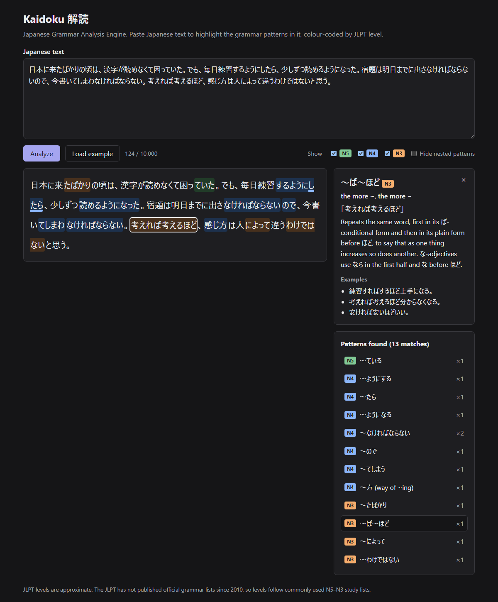
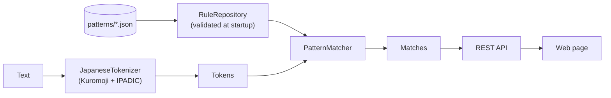

# Kaidoku (解読)

**Japanese Grammar Analysis Engine**

[](https://github.com/froxily/kaidoku/actions/workflows/ci.yml)
[](LICENSE)

Paste any Japanese text, such as a news article, a manga page, a subtitle line or an email, and Kaidoku highlights the grammar patterns it recognises. Each one is colour-coded by JLPT level (N5–N3), and clicking a highlight explains the pattern.

*Kaidoku* (解読) is Japanese for "deciphering". It is a **rule-based Java 21 / Spring Boot service, not an LLM**. Kuromoji splits the text into morphemes, and a small matching engine runs 199 hand-written JSON grammar rules over the token stream. The same input always gives the same output, it works offline, and every rule is backed by tests.



<!-- demo-gif: record it with docs/DEMO.md, save it as docs/demo.gif, then replace this comment with  -->

| | |
|---|---|
| Grammar patterns | **199** (24 N5 · 68 N4 · 107 N3), covering every in-scope N5 and N4 point of an openly licensed JLPT grammar checklist and 58 of its 62 N3 points ([coverage](#coverage)) |
| Tests | **1,343** unit and integration tests + **8** browser tests, run in CI on every push to `main` |
| Accuracy | **0.991 precision / 0.989 recall** on 655 evaluation sentences kept separate from the rules' own examples; the blind first runs scored 0.973 / 0.984 and 0.987 / 0.971 ([methodology](#evaluation)) |
| Speed | about **24 ms** to analyze 10,000 characters of grammar-dense text ([details](#performance)) |
| Stack | Java 21, Spring Boot 4.1, Kuromoji (IPADIC), vanilla JS, Docker, GitHub Actions, Playwright |

## Engineering highlights

- **Data-driven rule engine.** Grammar lives in JSON, not code. The loader validates every rule at startup and refuses to start on unknown fields, malformed steps, missing examples or a bad cross-reference.
- **NFA-style matcher.** Rules are indexed by their first token, and each match tracks the set of reachable token offsets, so optional steps, alternatives and bounded gaps never cause exponential backtracking.
- **Example-driven testing.** Each rule ships with its own examples and near-misses, a reviewed snapshot catches any rule that starts matching another rule's sentences, and a separate evaluation set measures precision and recall.
- **Production basics.** RFC 9457 error responses, input and body-size limits, a multi-stage Docker image that runs as a non-root user, and CI with a container smoke test.

## Why

Grammar patterns are the hard part of reading Japanese, because they span several words and change shape: わけではない can appear as わけじゃない, わけではありません or わけではなかった, and ている shrinks to てる or comes out as てた or てます. Dictionary tools look up words. I wanted something that marks the multi-word grammar in a whole text and says what level it is, mostly for my own N3 reading practice.

I couldn't find an open-source, rule-based tool that scans arbitrary Japanese text and labels grammar patterns by JLPT level, so I built one.

### Related tools

Each of these does something different. The descriptions come from each tool's own site, repository or store listing (checked 24 Oct 2026).

| Tool | What it does |
|---|---|
| [Bunpro](https://bunpro.jp) | Grammar study with spaced repetition; its example sentences are written in house |
| [Jisho](https://jisho.org/about) | Japanese–English dictionary; you can paste a whole paragraph, and it parses the text with MeCab to explain its words |
| [ichi.moe](https://ichi.moe) ([Ichiran](https://github.com/tshatrov/ichiran)) | Segments Japanese text into words and shows their JMdict meanings |
| [Yomitan](https://github.com/yomidevs/yomitan) | Pop-up dictionary browser extension and successor to Yomichan, for which community [grammar dictionaries](https://github.com/aiko-tanaka/Grammar-Dictionaries) exist |
| [Te-to-Te Reading Checker](https://www.intersc.tsukuba.ac.jp/~kyoten/en/?p=224) (University of Tsukuba) | Checks pasted text against several databases, including the Hagoromo function-word database, and charts the levels of its words and expressions |
| LLM-based analyzers, such as [Wakatta!](https://apps.apple.com/app/id6757565022) | AI-generated sentence breakdowns with grammar notes and JLPT tags |

Kaidoku's angle is narrower: a deterministic, open-source scan of a whole text that marks every grammar pattern it knows with a level, usable offline or through a REST API.

## Features

- **Variants of each pattern.** Rules cover the polite, casual, contracted and conjugated forms that apply. ～なければならない also matches なければなりません, なくてはいけない, なきゃならない, なくちゃだめ and more.
- **Whole conjugated words.** A highlight runs to the end of the word, so ようになった, てしまいました and ませんでした are marked in full.
- **Split patterns.** しか～ない, あまり～ない, ～たり～たりする, ～も～ば～も and わけでは決してない are matched across the words in between. The gap is bounded and never crosses a comma or the end of a sentence.
- **Overlapping patterns.** Nested matches are all shown; a rule can *subsume* a smaller one so it isn't reported twice, and a "Hide nested patterns" switch keeps only the outermost matches.
- **Honest about ambiguity.** When forms are identical at the token level, such as らしい after a noun ('seems' or 'typical of'), ～ませんか (invitation or negative question) or ～れる/～られる (passive, potential or respect), the card explains each reading instead of guessing.
- **Web page and REST API.** Level filters, explanation cards, a pattern list with counts, dark mode and a mobile layout, on top of an API that also works on its own.

<details>
<summary>All 199 patterns</summary>

- **N5 (24):** ～ている · ～てください · ～ないでください · ～たい · ～ましょう · ～でしょう · ～たことがある · ～前に · ～後で · ～から (reason) · ～ませんか · ～てから · ～に行く / ～に来る · ～がほしい · ～とき · ～たり～たりする · しか～ない · あまり～ない · 全然～ない · ～んです / ～のです · ～のが好きだ / ～のが上手だ · まだ～ていない · ～より～のほうが · ～の中で～が一番
- **N4 (68):** ～てしまう · ～なければならない · ～なきゃ / ～なくちゃ · ～ば · ～ようにする · ～ようになる · ～によると · ～ながら · ～ておく · ～てみる · ～てもいい · ～てはいけない · ～かもしれない · ～そうだ (looks like) · ～そうだ (I hear) · ～たら · ～ほうがいい · ～つもりだ · ～すぎる · ～はずだ · ～ことができる · ～てあげる · ～てくれる · ～てもらう · ～てある · ～ていく · ～てくる · ～やすい · ～にくい · ～ようと思う · ～ないといけない · ～なくてもいい · ～ので · ～のに · ～と (conditional) · ～なら · ～ばよかった · ～てほしい · ～始める · ～終わる · ～続ける · ～させる (causative) · ～れる / ～られる · ～みたいだ · ～くなる / ～になる · ～ほど～ない · ～し · ～に～回 · ～がる · ～たらどうですか · (number)も · ～(よ)う · ～ていただけませんか · ～といい · ～てすみません · ～なさい · ～ても · ～てくれてありがとう · ～てよかった · ～ないで · ～かどうか · ～という · ～間 / ～間に · ～くする / ～にする · ～のような / ～のように · ～させられる · ～方 (way of ~ing) · ～ばいい / ～たらいい
- **N3 (107):** ～わけではない · ～ことになる · ～たばかり · ～ば～ほど · ～によって · ～わけがない · ～はずがない · ～ことにする · ～ばかり · ～ところだ · ～にとって · ～おかげで · ～せいで · ～ために · ～ためになる · ～らしい · ～らしい (after a noun) · ～っぽい · ～わりに · ～最中に · ～ようだ · ～に違いない · ～に決まっている · ～について · ～に対して · ～として · ～に関して · ～に比べて · ～にしては · ～たびに · ～うちに · ～ずに · ～たとたん · ～べきだ · ～っけ · ～なんて · ～がち · ～だらけ · ～出す · ～ようとする · ～ことはない · ～ついでに · ～かわりに · 決して～ない · ～も～ば～も · ～さえ～ば · とても～ない · ～て初めて · ～で有名 · ～をはじめ · ～的 · ～くらい / ～ぐらい (extent) · ～ほど (extent) · ～まま · ～としたら / ～とすれば · ～たて · ～きり / ～っきり · ～ふりをする · ～まい · ～さえ · なかなか～ない · ～ず · ～ように · ～こそ · ～に限る · ～とともに · ～にすぎない · ～において / ～における · ～げ · ～しかない · ～につれて · ～にしたがって · ～わけにはいかない · ～てたまらない / ～てしかたがない · ～くせに · たとえ～ても · ～おきに · ～わけだ · ～とおりに · ～をこめて · ～を通じて / ～を通して · ～だけでなく · わざわざ · まさか · いったい · どうやら · さらに · すでに · つい · むしろ · どうしても · せいぜい · ～とは限らない · ～ないことはない · ～から～にかけて · ～気味 · ～向け · ～をもとに · ～に反して · ～としても · ～ばかりか · ～ということだ · ～というより · ～に代わって · ～にしても · ～気がする · ～てからでないと

</details>

### Coverage

The checklist is the N5, N4 and N3 grammar lists of the Wikibooks [JLPT Guide](https://en.wikibooks.org/wiki/JLPT_Guide). Basic particles and sentence frames from the N5 list (は, を, に, で, も, と, や, です, ～があります, ～がいます) aren't highlighted, because they would mark almost every word.

| Level | Points on the list | In scope | Covered |
|---|---|---|---|
| N5 | 40 | 29 | 29 |
| N4 | 50 | 50 | 50 |
| N3 | 62 | 62 | 58 |

The four N3 gaps are explained under [Limitations](#limitations). Other rules cover common N4 and N3 points the list leaves out, such as ～につれて, ～わけにはいかない, ～くせに and ～ばかりか.

## Quick start

You need Java 21 and Git. On Windows, use `mvnw.cmd` instead of `./mvnw`.

```bash
git clone https://github.com/froxily/kaidoku.git
```

```bash
cd kaidoku
```

```bash
./mvnw spring-boot:run
```

Open http://localhost:8080 and click **Load example**. The port comes from the `PORT` environment variable and defaults to 8080.

Or with Docker:

```bash
docker build -t kaidoku .
```

```bash
docker run -p 8080:8080 kaidoku
```

Run the tests:

```bash
./mvnw test
```

```bash
./mvnw verify -Pe2e
```

The second command adds the browser tests. They use an installed Edge by default (`-De2e.browser.channel=chrome` for Chrome) and never download a browser. For a scripted walkthrough and how to record a demo GIF, see [docs/DEMO.md](docs/DEMO.md).

## API

```bash
curl -s -X POST http://localhost:8080/api/analyze \
  -H 'Content-Type: application/json' \
  -d '{"text": "高いわけではない。"}'
```

```json
{
  "tokens": [
    { "surface": "高い", "baseForm": "高い", "pos": "形容詞", "reading": "タカイ", "start": 0, "end": 2 }
  ],
  "matches": [
    {
      "ruleId": "wake-dewa-nai",
      "pattern": "～わけではない",
      "level": "N3",
      "meaning": "it's not that ~ / it doesn't necessarily mean ~",
      "explanation": "Denies a conclusion the listener might reasonably draw, …",
      "start": 2,
      "end": 8,
      "text": "わけではない"
    }
  ]
}
```

The token list is shortened here. `start` and `end` are UTF-16 offsets, so they line up with JavaScript string indices, and matches come back in text order, longer first.

| Endpoint | Purpose |
|---|---|
| `POST /api/analyze` | Tokens and grammar matches for a text |
| `GET /api/patterns?level=N3` | The rules, without their matching steps; `level` is optional |
| `GET /api/tokens?text=…` | Raw Kuromoji tokens, for writing rules |

Errors use RFC 9457 `application/problem+json`: **400** for blank text, more than 10,000 characters, malformed JSON or an unknown level, and **413** for a body over 64 KiB, which is rejected before the JSON is parsed.

## How it works



1. **Tokenize.** Kuromoji splits the text into tokens with surface form, base form, part of speech, conjugation, reading and offsets. It sits behind a small `JapaneseTokenizer` interface, so another analyzer can replace it.
2. **Index.** Each rule is indexed by the surface form, base form or part of speech of its first step, so at each token only the rules that could start there are tried.
3. **Match.** A rule is a sequence of steps. A step constrains one token with exact values, offers alternative sub-sequences (`anyOf`), or skips a bounded number of tokens (`gap`) for split patterns. A gap is lazy, so しか pairs with the first ない after it, and it never crosses 。、, brackets, line breaks or ！？. Rules can also require the next token (`followedBy`, used to tell sentence-final なきゃ from the conditional) or reject certain preceding tokens (`notPrecededBy`, which keeps ～ていく off どうやって行きますか). The longest match wins.
4. **Complete the word.** The span extends over the rest of the conjugated word: endings such as た, ます, ない, たい and ん, a て that completes a te-form, and ませんでした.
5. **Subsume and sort.** A match inside a longer match of a rule that declares `subsumes` (or of the same rule) is dropped, and the rest come back in text order.

A real rule from `src/main/resources/patterns/n3.json`, with the explanation shortened:

```json
{
  "id": "wake-dewa-nai",
  "pattern": "～わけではない",
  "level": "N3",
  "meaning": "it's not that ~ / it doesn't necessarily mean ~",
  "explanation": "Denies a conclusion the listener might reasonably draw, …",
  "steps": [
    { "surface": ["わけ", "訳"], "pos": "名詞", "pos2": "非自立" },
    { "anyOf": [
      [ { "surface": "で", "baseForm": "だ" }, { "surface": "は", "pos": "助詞" } ],
      [ { "surface": "じゃ" } ]
    ] },
    { "gap": 1 },
    { "anyOf": [
      [ { "baseForm": "ない" } ],
      [ { "baseForm": "ある" }, { "baseForm": "ます" }, { "surface": "ん" } ]
    ] }
  ],
  "examples": ["高いわけではない。", "嫌いなわけじゃないよ。", "行きたくないわけではありません。", "全部読んだわけではなかった。"],
  "counterExamples": ["そんなわけがない。", "わけを教えてください。", "だから遅れたわけです。"]
}
```

To add a rule: dump the tokens of its example sentences with `/api/tokens` first (tokenization often surprises you: in では the で is the copula だ), write the steps against that output with at least two examples and one near-miss, then run `./mvnw test` and review the snapshot diff it reports before accepting it with `-Dcrosscheck.update=true`.

## Quality

### Tests

| Test class | Tests | What it covers |
|---|---|---|
| `PatternExamplesTest` | 1,216 | Every rule's examples match it, and every counter-example doesn't |
| `RuleRepositoryTest` | 34 | Rule loading and each fail-fast validation |
| `MatchSpanTest` | 27 | Exact highlight spans on real sentences |
| `PatternMatcherTest` | 28 | Optional steps, `anyOf`, gaps, longest match, overlaps, subsumption, offsets, word completion, `followedBy`, `notPrecededBy` |
| `AnalyzeControllerTest`, `TokenControllerTest`, `PatternControllerTest`, `RequestBodySizeLimitTest` | 24 | API contract, validation, limits and error format |
| `KuromojiTokenizerTest` | 7 | Offsets cover the whole text, exact token output, thread safety |
| `RuleConsistencyTest` | 3 | Cross-rule checks (below) |
| `EvaluationTest` | 3 | Accuracy on the evaluation set (below) |
| `PatternMatcherPerformanceTest` | 1 | Twenty 10,000-character analyses within a time budget |
| `KaidokuE2eTest` (`-Pe2e`) | 8 | In a real browser: highlighting, cards, level filter, overlaps, hiding nested patterns, mobile layout, invalid input |

GitHub Actions runs three jobs on every push to `main` and every pull request: the test suite, the browser tests (in Chrome), and a Docker build that starts the container and checks it answers correctly as a non-root user.

**Cross-rule checks.** `RuleConsistencyTest` keeps every match on all 1,119 example sentences in a reviewed snapshot, so a rule that starts matching another rule's sentences fails the build until the change is reviewed. It also checks that every declared `subsumes` actually suppresses a match, and that no two rules highlight exactly the same span.

### Evaluation

Two sets of sentences are kept apart:

| Set | Size | Written by | What it is for |
|---|---|---|---|
| **Development examples**: each rule's `examples` and `counterExamples` | 1,119 sentences | Written together with the rules | Building and regression-testing the rules. They pass by construction, so they say nothing about accuracy |
| **Evaluation set**: `src/test/resources/evaluation/cases.json` | 655 sentences, 195 of them near-misses | Drafted and labelled by a separate model (OpenAI Codex) | Measuring precision and recall. A test fails if any of them repeats a development example |

The evaluation set was built in two rounds:
- **Round 1:** 220 sentences (60 near-misses) for the first 49 rules. Codex worked in the project checkout, so it was not technically prevented from reading the rules.
- **Round 2:** 435 sentences (300 positives, 135 near-misses) for the other 150 rules, plus their labels on the first 220. Codex was given only each rule's name, meaning and explanation and told not to open the rules or their examples; that was an instruction, not a sandbox restriction.

| Run | Rules | Precision | Recall | F1 | Exact sentences |
|---|---|---|---|---|---|
| Round 1, blind first run | 49 | 0.973 | 0.984 | 0.978 | 212 / 220 |
| Round 2, blind first run | 199 | 0.987 | 0.971 | 0.979 | 629 / 655 |
| ↳ the 150 rules evaluated for the first time | 150 | 0.985 | 0.956 | 0.970 | |
| **Current**, after fixes | 199 | **0.991** | **0.989** | **0.990** | 642 / 655 |

"Blind" means the first run, before any rule was changed in response. The errors each round found led to targeted rule fixes, so the current numbers are no longer blind for those sentences, and in round 2 the 49 older rules had already been tuned on round 1. Two round-2 labels were corrected afterwards, because a subsumption added later hides the ～と they listed.

The evaluation is deterministic: `./mvnw test -Dtest=EvaluationTest` writes per-rule counts and every error to `target/evaluation-report.md`, and it fails if precision or recall drops below 0.98. Each row above was re-run from a clean checkout of the development history and reproduced exactly, and the current numbers reproduce from this repository with the command above.

The 13 remaining errors are limits of token-level matching:
- **6 false positives:** 念のため ('just in case') read as ～ために, ところ meaning 'place', のに meaning 'in order to', お世話になる read as 'become', 有名 after a place marked with で, and 診せる, which the dictionary splits like a causative.
- **7 misses:** a verb stem tagged as a noun (見え方, 作りに来た), 魚 tagged as a suffix, 吹き出す as one word, のに as two tokens, a conditional と tagged as a quotation particle (頼まれると), and a destination between ～に and the verb (置きに二階へ上がった).

## Performance

Measured on one laptop (Intel Core i5-12450H, 12 threads) with JDK 21, as the median of 100 runs after JVM warm-up. The input is 9,990 characters built by packing the rules' example sentences together, far denser in grammar than real prose: 6,291 tokens and 911 matches.

| Stage | Median | p90 |
|---|---|---|
| Tokenize (Kuromoji) | 8.4 ms | 9.6 ms |
| Match (199 rules) | 15.9 ms | 17.3 ms |

Your numbers will vary with the machine and its load.

## Limitations

- **JLPT levels are unofficial.** The JLPT hasn't published official grammar lists since 2010, so the levels follow commonly used N5–N3 study lists.
- **Split patterns are bounded.** A gap spans at most a few tokens (set per rule, at most 8) and stops at punctuation, so a pattern spread over a long clause, or across a comma the rule doesn't expect, is missed.
- **Four checklist points aren't covered.** ～たものだ ('used to') has the same tokens as 'a thing that was ~'; かえって ('on the contrary') is also how kana 帰って is tagged; kana なれる in ～になれる is also 慣れる; and ～には～の～がある has no reliable token signature yet.
- **Some readings can't be told apart from tokens alone.** The card says so instead of guessing, but a few cases still produce false positives (see [Evaluation](#evaluation)). A few rules list single-word forms by hand (っぽい adjectives, some ～方 and ～たて words), so unlisted words are missed.
- **Bare なきゃ / なくちゃ is only matched at the end of a sentence.** Mid-sentence, the same form usually means 'if (you) don't'.
- **Inline furigana breaks tokenization.** Text copied with readings mixed in (気象庁きしょうちょう) confuses the tokenizer, so copy it without furigana.

## Roadmap

- N2 patterns
- Furigana from token readings
- Click a word to look it up in JMdict
- A sentence miner for subtitle files (.srt) that finds sentences with exactly one unknown word
- Export the patterns found to Anki

## Acknowledgements

- [Kuromoji](https://github.com/atilika/kuromoji) by Atilika (Apache License 2.0), with its bundled IPADIC dictionary, does the morphological analysis.
- The N5–N3 coverage checklist is the grammar lists of the Wikibooks [JLPT Guide](https://en.wikibooks.org/wiki/JLPT_Guide) (compiled by Jonathan Waller, CC BY-SA 4.0). Only pattern names and levels were used as a checklist; no text from it is included here.
- The rules' examples and explanations were written for this project. The evaluation sentences were drafted by OpenAI Codex, as described under [Evaluation](#evaluation).

## License

[MIT](LICENSE) © 2026 Akshat. Kuromoji and its bundled IPADIC dictionary are distributed under their own licenses.
